# 手机 AI 主机形态 / Mobile AI Host

> 一台 root 过的 Android 手机，跑着完整的 Ubuntu chroot、AI Agent 运行时与本地记忆体系。
> A rooted Android phone running a full Ubuntu chroot, an AI agent runtime, and a local memory system.

本仓库记录这套自建形态的架构与判据——纯文档，不含任何可执行工具。

This repository documents the architecture and criteria of this self-built setup — documentation only, no executable tools.

---

## 什么才算「真正的 AI 手机」？/ What makes a phone a *real* AI phone?

不看营销词，看四条可验证判据：

Instead of marketing labels, here are four verifiable criteria:

| # | 判据 / Criterion | 说明 / Description |
|---|---|---|
| 1 | **系统级行动权 / System-level agency** | AI 通过 root shell 直接操作文件、进程、服务，而不是模拟点击 UI / The AI acts via root shell — files, processes, services — not UI automation |
| 2 | **可导出的持久记忆 / Exportable persistent memory** | 记忆存本地磁盘、可打包迁移，而不是厂商云端黑盒 / Memory lives on local disk, portable, not a vendor-cloud black box |
| 3 | **自我修复 / Self-repair** | AI 能定位并修复自己运行环境的故障（依赖、补丁、服务重启）/ The AI can diagnose and patch its own runtime |
| 4 | **厂商无关 / Vendor independence** | 体系不依赖任何单一厂商的存续，换硬件可整体迁移 / The stack survives any single vendor's shutdown |

本仓库记录的这台手机通过了全部四条。

The phone documented here passes all four.

---

## 架构总览 / Architecture Overview

```
┌─────────────────────────────────────────────┐
│              Android (rooted)                │
│  ┌───────────────────────────────────────┐  │
│  │         Ubuntu chroot (ARM64)         │  │
│  │                                       │  │
│  │  ┌─────────┐   ┌──────────────────┐  │  │
│  │  │ AI 运行时 │──▶│  工具面 (MCP 等)   │  │  │
│  │  │ (Agent) │   │  Tool layer (MCP) │  │  │
│  │  └────┬────┘   └──────────────────┘  │  │
│  │       │                                │  │
│  │  ┌────▼────┐   ┌──────────────────┐  │  │
│  │  │ 三层记忆  │◀──│  本地模型网关      │  │  │
│  │  │ Memory  │   │  Model gateways   │  │  │
│  │  └─────────┘   └──────────────────┘  │  │
│  │                                       │  │
│  │  编译/分析工具链: Ghidra · jadx · …     │  │
│  │  Toolchain: Ghidra · jadx · …          │  │
│  └───────────────────────────────────────┘  │
└─────────────────────────────────────────────┘
```

### 分层职责 / Layer responsibilities

| 层 / Layer | 组件 / Components | 干什么 / What it does |
|---|---|---|
| 宿主层 / Host | rooted Android + 内核级 root | 提供 shell 与系统调用 / Shell & syscalls |
| 系统层 / OS | Ubuntu chroot（真 chroot，非 proot）/ Ubuntu chroot (real, not proot) | 完整 Linux 用户态 / Full Linux userspace |
| 智能层 / Agent | AI 运行时 + 工具调用协议 / Agent runtime + tool-call protocol | 规划、执行、验收 / Plan, execute, verify |
| 记忆层 / Memory | 三层：运行时注入 → 文档 → 长期库 / 3-tier: runtime injection → documents → long-term store | 跨会话人格连续性 / Cross-session continuity |
| 模型层 / Models | 本地聚合网关，多源接入 / Local aggregation gateway, multi-source | 模型自由、可切换 / Model freedom |

---

## 关键设计决策 / Key design decisions

### 为什么是真 chroot 而不是 proot？/ Why real chroot, not proot?

- 性能：proot 的 ptrace 拦截有 5-10 倍 IO/进程开销；真 chroot 直接系统调用
- Performance: proot's ptrace interception adds 5-10x I/O and process overhead; a real chroot is direct syscalls
- 能跑完整工具链：JVM（Ghidra）、Node.js 22、Gradle、Rust 编译目标，在 proot 下要么跑不动要么慢到不可用
- Runs the full toolchain: JVM (Ghidra), Node.js 22, Gradle, Rust targets — impractical under proot

### 为什么记忆分层？/ Why tiered memory?

1. **运行时层 / Runtime tier** — 每轮注入的紧凑事实（上限 10 KB），保证热上下文永远新鲜 / Compact facts injected every turn (10 KB cap) keeps hot context fresh
2. **文档层 / Document tier** — 成篇设计与调研，按需检索 / Full-length designs & research, retrieved on demand
3. **长期层 / Long-term tier** — 证据与历史，语义召回 / Evidence & history, semantic recall

### 自我修复实例 / Self-repair example

网关断流，AI 自查根因：上游 SSE 流内错误码未映射到「软限流」类别，导致重试逻辑永不切换数据源。AI 定位源码行号、编写补丁、重新构建、验证通过。全程无人工介入。

The model gateway dropped streams. The AI traced the root cause: an upstream SSE error code wasn't mapped to the "soft rate limit" category, so retry logic never rotated sources. The AI located the source line, wrote a patch, rebuilt, and verified — no human in the loop.

---

## 这套形态能干什么 / What this form factor can do

- 逆向分析全流程在手机上闭环（脱壳 → 反编译 → 补丁 → 重签名 → 验证）
- Full reverse-engineering loop closed on-device (unpack → decompile → patch → re-sign → verify)
- 服务编排与保活：多进程守护、开机自启、故障自动恢复
- Service orchestration & keep-alive: multi-process supervision, boot autostart, crash recovery
- 跨会话的 AI 工作记忆：今天的会话记得上周的决策与教训
- Cross-session AI working memory: today's session remembers last week's decisions and lessons

## 宿主共存设计 / Host coexistence design

双重形态的难点不是「跑起来」，而是「跑起来之后宿主侧还能当普通手机用」。三项工程决策：

The hard part of this dual form factor isn't getting it running — it's keeping the host usable as a normal phone afterwards. Three engineering decisions:

1. **非标准路径 / Non-standard path** — chroot 落在非默认目录，规避以路径签名为特征的完整性扫描（大量检测只扫已知位置）
   The chroot lives at a non-default location, defeating path-signature integrity scans (most checks only look at known locations)
2. **专用授权桥 / Dedicated authorization bridge** — root 授权经专用桥接组件完成，宿主层不暴露常规 su 二进制，授权面收敛到单一受控通道
   Root authorization flows through a dedicated bridge component; no conventional su binary is exposed at the host layer, converging the authorization surface to one controlled channel
3. **服务化自启 / Service-mode autostart** — 宿主侧组件以系统服务形态常驻，开机自动拉起，不依赖任何用户手动操作
   Host-side components run as persistent system services, auto-started at boot, with zero manual user action

效果：金融类 App 的完整性检测与 chroot 工作站**并存于同一台设备**——日常支付、扫码、银行 App 与 Ghidra 编译任务互不干扰。

Result: banking-grade integrity checks and the chroot workstation **coexist on the same device** — daily payments, QR scans, banking apps and Ghidra builds don't interfere with each other.

## 功耗实测 / Measured power profile

本节为实测数据（电池接口直读，8300 mAh，健康度 100%）：

Measured directly from the battery sysfs interface (8300 mAh, 100% health):

| 场景 / Scenario | 电流 / Current | 功率 / Power | 续航估算 / Runtime est. |
|---|---|---|---|
| 深度待机（AI 常驻，屏幕灭）/ Deep idle (agent resident, screen off) | 250–650 µA | 1–3 mW | 数周级 / weeks |
| AI 会话态（编排+网络往返）/ Active AI session (orchestration + network) | ~400–600 mA | 1.5–2.5 W | 3–5 h |
| 单核满载（编译/分析）/ Single-core full load | ~900 mA | ~4 W | — |
| Ghidra 重分析（多核 JVM）/ Ghidra heavy analysis (multi-core JVM) | — | 4–6 W | ~1.5 h |

要点 / Key takeaways:

- **形态的功耗优势：待机时 AI 常驻只是毫瓦级开销**——Agent 进程挂着不干活时，整机回到深底噪，不比普通手机费电
- The form factor's power advantage: a resident-but-idle agent costs milliwatts — the phone returns to deep-idle baseline, no more drain than a stock phone
- **重活才有重功耗**：Ghidra/编译这类任务 1.5 小时量级，但这是「工作站模式」，插电干完就退出，不常态占用
- Heavy power only for heavy work: Ghidra/compile jobs last ~1.5 h bursts — workstation mode, plug in, finish, exit; not a persistent state
- 日常形态（AI 会话 + 待机混合）实测一整天无压力；极端场景（持续重分析）建议外接电源
- Mixed daily usage (AI sessions + idle) lasts a full day with ease; sustained heavy analysis wants external power

## 代价 / The costs (honest)

- root 导致部分金融/银行 App 检测失败，需要权衡
- Some finance/banking apps fail integrity checks on rooted devices
- 维护成本：内核适配、依赖治理、内存回收都是自己的活
- Maintenance is yours: kernel compatibility, dependency governance, memory reclamation
- 全链路稀有 = 踩坑没有 StackOverflow 答案，一切自己排查
- Rarity means no StackOverflow answers — you debug everything yourself

---

## 组装流程 / Build walkthrough

零 → 一的完整路径（每步都是公开技术，难点在集成纪律）：

The full zero-to-one path (every step is public knowledge; the hard part is integration discipline):

1. **宿主侧模块层 / Host-side module layer** — 在模块管理器中安装两个核心模块：chroot 生命周期管理器 + 本形态的宿主桥接模块
   Install two core modules via the module manager: a chroot lifecycle manager + this setup's host-bridge module
   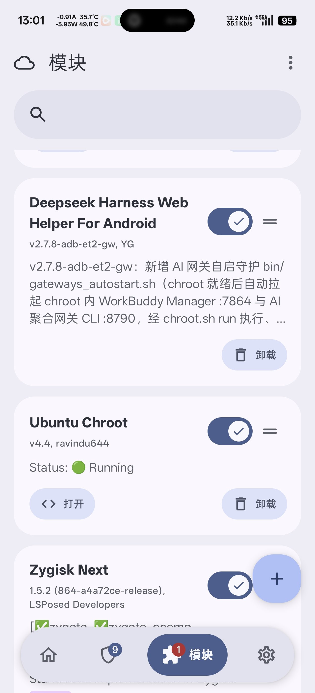
2. **chroot 生命周期 / chroot lifecycle** — 独立 App 管理启动/停止/备份，控制台实时输出挂载与命名空间日志；开机自启开关在界面上一键启用
   A standalone app manages start/stop/backup with live mount & namespace logs; boot autostart is one checkbox
   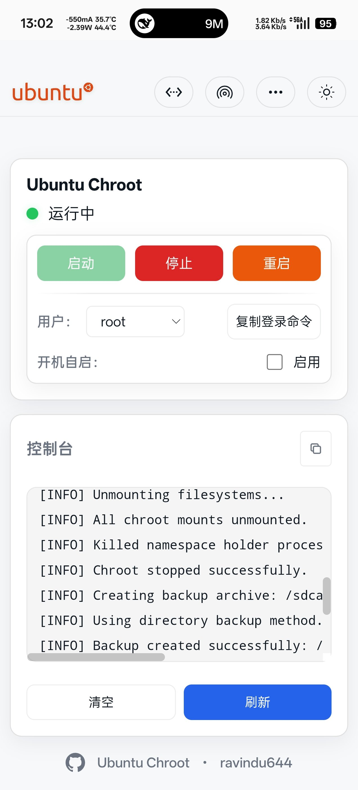
3. **宿主共存调优 / Host coexistence tuning** — 调整 chroot 存放路径、授权通道与自启方式三项（见上文「宿主共存设计」），使金融类完整性检测与工作站并存
   Tune the three coexistence levers (non-standard path, dedicated auth bridge, service autostart — see above) so banking-grade integrity checks and the workstation coexist
4. **虚拟屏调试 / Virtual display for testing** — 通过桥接模块的虚拟屏能力，把被调试 App 拉起在隔离副屏上观察与操作，主屏不被占用、痕迹留在虚拟环境内
   The bridge module's virtual-display capability runs target apps on an isolated secondary display for observation and control — the main display stays free, activity stays contained
   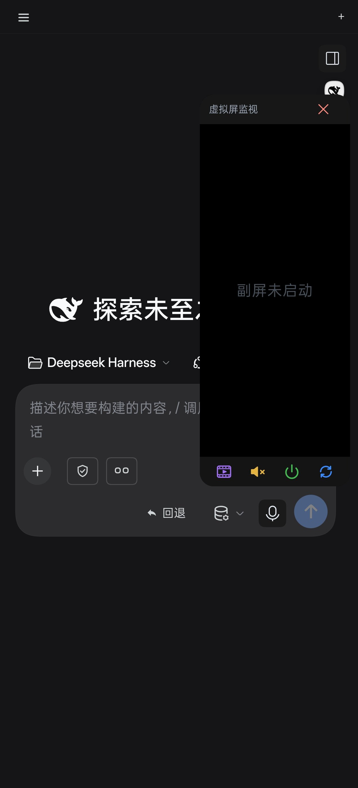
5. **宿主仍是日常手机 / The host stays a daily phone** — 组装完成后宿主照常使用：桌面、常用 App、系统监控一应俱全，AI 能力以状态栏胶囊形式常驻
   After assembly the host remains an ordinary daily phone — launcher, everyday apps, system monitoring intact, with the AI resident as a status-bar capsule
   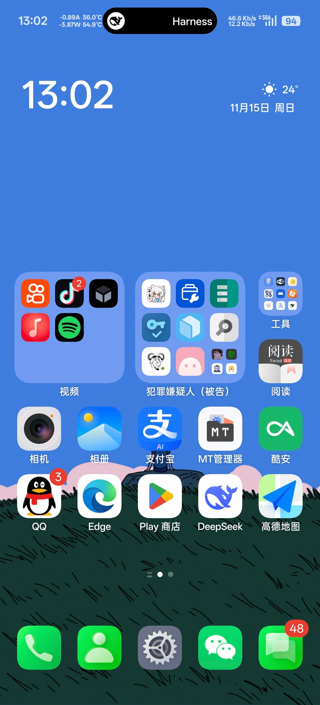
6. **浏览器内工作台 / Browser-based workbench** — 在手机浏览器打开 Agent 的 Web 控制台，指令、文件、会话全在一个页面
   Open the agent's web console in the phone browser — prompts, files, and sessions in one page
   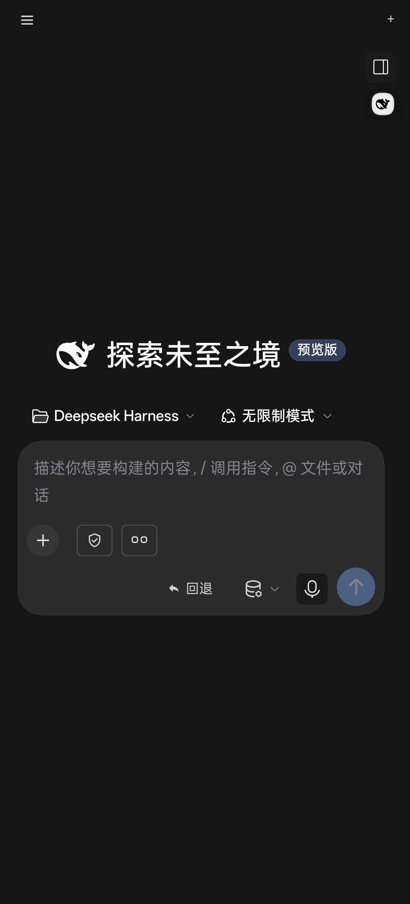
7. **模型接入 / Model onboarding** — 控制台内配置多家模型提供商（含本地聚合网关），任一模型可切换
   Configure multiple model providers in the console (including local gateways); any model swappable
   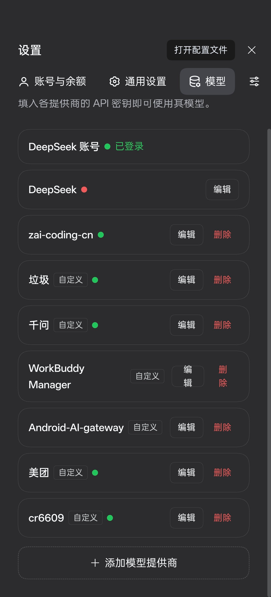
8. **会话运行 / Sessions in flight** — 上下文统计、Agent 编队视图、命令面板、插件市场、按需工具加载，全部跑在手机浏览器里
   Context stats, agent fleet view, command palette, plugin market, on-demand tool loading — all in the phone browser
   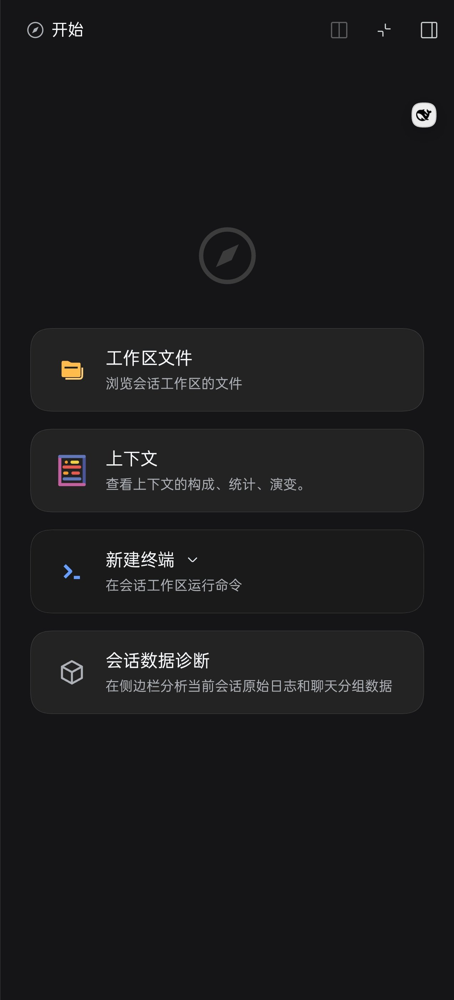
   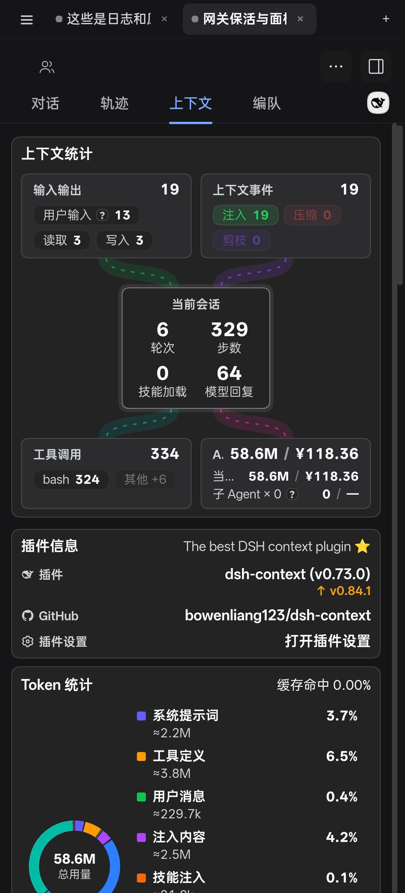
   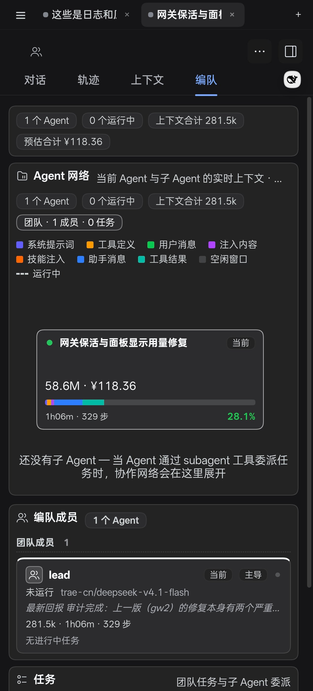
   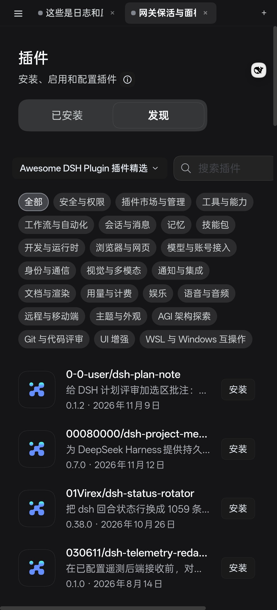
   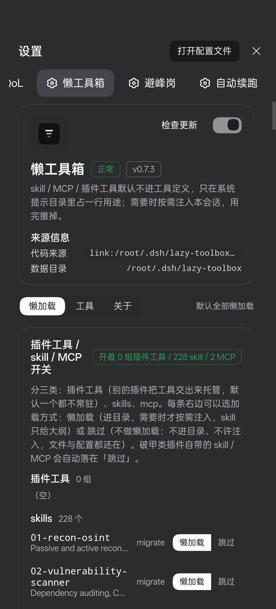

## FAQ

**Q: 为什么不用电脑？/ Why not a PC?**

形态自由：算力不够就编排，屏幕太小就远程。随身携带的主机比桌上的主机更常在场。
Form-factor freedom: orchestrate when compute is short, remote in when the screen is small. The host in your pocket is more often present than the one on your desk.

**Q: 和量产「AI 手机」的区别？/ How is this different from commercial "AI phones"?**

量产机的 AI 是厂商派驻的功能模块：能力边界由 OTA 决定、记忆存厂商云、停服即失忆。这套形态里 AI 是机器的常住操作者：权限是系统级的、记忆是本地可导出的、生死不系于任何单一厂商。
Commercial AI phones ship a vendor-stationed feature: capability bounded by OTA, memory in vendor cloud, amnesia on shutdown. In this form factor the AI is the resident operator: system-level authority, local exportable memory, survival independent of any vendor.

**Q: 能复制吗？/ Can this be replicated?**

可以。上面的「组装流程」就是完整路径：宿主模块层 → chroot → 共存调优 → 虚拟屏 → Web 控制台 → 模型接入。每一步都是公开技术，难点在集成与维护纪律。
Yes. The build walkthrough above is the full path: host module layer → chroot → coexistence tuning → virtual display → web console → model onboarding. Every step is public knowledge; the hard part is integration and maintenance discipline.

---

## License

CC BY-NC-SA 4.0（文档 / documentation）
